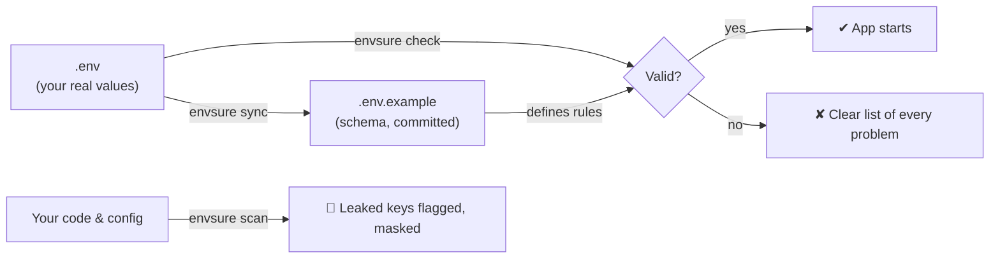

<div align="center">

# 🛡️ envsure

**Catch broken config and leaked API keys before they break your app or reach GitHub.**

[](https://github.com/Hafsa-Anwar65/envsure/actions/workflows/ci.yml)
[](https://github.com/Hafsa-Anwar65/envsure/releases)


[](LICENSE)

[Quick start](#-quick-start) · [Commands](#-commands) · [Python API](#-python-api) · [CI & pre-commit](#-use-it-in-ci-and-pre-commit) · [Docker](#-docker)

</div>

---

## What is envsure?

Almost every project keeps its settings — database URLs, API keys, ports — in a `.env` file, with a `.env.example` committed to the repo so teammates know what to fill in.

That setup breaks in three predictable ways:

| Problem | What happens | envsure fixes it with |
|---|---|---|
| **Missing or wrong values** | A teammate pulls your branch and the app crashes on startup because `DATABASE_URL` isn't set, or `PORT=abc`. | `envsure check` |
| **Outdated `.env.example`** | You add a new key to `.env` and forget the example. Nobody trusts the example any more. | `envsure sync` |
| **Leaked secrets** | A real `sk-...` key gets pasted into `.env.example` or a config file and pushed to GitHub. | `envsure scan` |

envsure is a small command-line tool and Python library that handles all three. It has **zero dependencies**, runs in under a second, and works the same on your laptop, in pre-commit and in CI.



---

## ⚡ Quick start

**1. Install**

```bash
pip install git+https://github.com/Hafsa-Anwar65/envsure.git
```

**2. Add rules to your existing `.env.example`** — just put a `[type]` at the start of the comment. Everything else stays a normal `.env.example`.

```bash
PORT=8000            # [port] port the API listens on
DEBUG=false          # [bool, optional]
DATABASE_URL=        # [url] postgres connection string
OPENAI_API_KEY=      # get one at platform.openai.com
```

**3. Run it**

```console
$ envsure check
ERROR   invalid   PORT: must be a port between 1 and 65535 (got '99999')
ERROR   missing   DATABASE_URL: not set — postgres connection string
ERROR   empty     OPENAI_API_KEY: is empty — get one at platform.openai.com
WARNING extra     STRIPE_KEY: not documented in .env.example
✘ 4 keys checked, 3 error(s), 1 warning(s)
```

Every problem is listed at once, with the description you wrote, so the person fixing it knows exactly what to do.

---

## 🧰 Commands

### `envsure check` — validate your environment

Compares `.env` (or the real process environment) against the rules in `.env.example`.

**Supported rules**

| Rule | Accepts |
|---|---|
| `str` *(default)* | any text |
| `int`, `float` | numbers |
| `bool` | `true/false`, `1/0`, `yes/no`, `on/off` |
| `port` | integer from 1 to 65535 |
| `url` | `https://…`, `postgres://…`, `redis://…`, `sqlite:///…` |
| `email` | email address |
| `json` | valid JSON, e.g. `{"new_ui": true}` |
| `choice=a\|b\|c` | one of the listed values |
| `optional` | may be left out — falls back to the value in `.env.example` |

Keys without a rule are treated as **required text**. Rules combine with commas: `# [int, optional]`.

**Options**

| Flag | Purpose |
|---|---|
| `--strict` | treat keys missing from `.env.example` as errors |
| `--environ` | also read the process environment |
| `--no-file` | read **only** the process environment (CI, Docker, Kubernetes) |
| `--json` | machine-readable output |
| `--env PATH`, `--example PATH` | use different file names |

Exit codes: `0` all good · `1` problems found · `2` invalid input (e.g. a typo in a rule).

### `envsure sync` — keep `.env.example` up to date

Copies keys that exist in `.env` but not in `.env.example`, **with values removed** and the type guessed for you.

```console
$ envsure sync
Added to .env.example (values blanked): REDIS_URL, WORKERS
```

```bash
# appended to .env.example
REDIS_URL=  # [url]
WORKERS=  # [int]
```

Existing lines are never rewritten or reordered.

- `--prune` — also remove keys you deleted from `.env`
- `--check` — change nothing; exit with `1` if the example is out of date

### `envsure scan` — find leaked secrets

Scans files or whole folders for real-looking credentials.

```console
$ envsure scan .
config/settings.py:12  OpenAI API key  sk-p************a1B2
docker-compose.yml:8   Password in URL  S3cr************Pw99
✘ 2 possible secret(s) found.
```

**Detects:** OpenAI · Anthropic · GitHub · AWS · Google · Slack · Stripe · Hugging Face · Groq · JWTs · private keys · passwords inside connection URLs.

- Secrets are **always masked** in output, so logs stay safe.
- Placeholders such as `sk-your-key-here`, `xxxx`, `<token>` or `${DB_PASSWORD}` are ignored.
- Add `envsure: ignore` to a line to silence a false positive.
- Skips `.git`, `node_modules`, virtual environments and binary files.

`envsure check` also scans `.env.example` automatically, so a real key can never sit in your example file unnoticed.

---

## 🐍 Python API

Validate and load settings at app startup — and get real Python types back instead of strings.

```python
from envsure import load

cfg = load()               # reads .env, validates against .env.example

cfg.PORT                   # 8000          (int)
cfg.DEBUG                  # False         (bool)
cfg.FEATURE_FLAGS          # {'new_ui': True}  (dict, from json)
cfg["DATABASE_URL"]        # 'postgres://…' (str)
```

If anything is wrong, `load()` raises `envsure.EnvsureError` listing **every** problem — not just the first one.

| Behaviour | Default | Change it with |
|---|---|---|
| Real environment variables override `.env` | on | `load(environ_wins=False)` |
| Values from `.env` are copied into `os.environ` | on | `load(export=False)` |
| File locations | `.env`, `.env.example` | `load(example=..., env=...)` |

You can also call `check()`, `sync()` and `scan_paths()` directly — they return structured results instead of printing.

---

## 🔁 Use it in CI and pre-commit

### pre-commit

Block secrets and stale examples before a commit is even made:

```yaml
# .pre-commit-config.yaml
repos:
  - repo: https://github.com/Hafsa-Anwar65/envsure
    rev: v0.1.0
    hooks:
      - id: envsure-scan    # stop commits that contain secrets
      - id: envsure-sync    # stop commits when .env.example is missing keys
```

### GitHub Actions

```yaml
steps:
  - uses: actions/checkout@v4

  # Fail the build if any secret is committed
  - uses: Hafsa-Anwar65/envsure@v0.1.0
    with:
      command: scan

  # Fail the build if required config is missing in CI
  - uses: Hafsa-Anwar65/envsure@v0.1.0
    env:
      DATABASE_URL: ${{ secrets.DATABASE_URL }}
      OPENAI_API_KEY: ${{ secrets.OPENAI_API_KEY }}
    with:
      command: check
      args: --strict
```

---

## 🐳 Docker

No Python needed — run the published image from GitHub Packages:

```bash
docker run --rm -v "$PWD:/work" ghcr.io/hafsa-anwar65/envsure check
docker run --rm -v "$PWD:/work" ghcr.io/hafsa-anwar65/envsure scan .
```

---

## How it compares

envsure is intentionally small and focused. It works well **alongside** these tools:

| Tool | Loads `.env` | Validates types | Syncs `.env.example` | Scans for secrets |
|---|:---:|:---:|:---:|:---:|
| python-dotenv | ✅ | — | — | — |
| pydantic-settings | ✅ | ✅ (in Python code) | — | — |
| gitleaks / trufflehog | — | — | — | ✅ (deep, full history) |
| **envsure** | ✅ | ✅ (in `.env.example`) | ✅ | ✅ (fast, working tree) |

The difference: envsure keeps the rules **in `.env.example` itself**, so the file every developer already reads becomes the single source of truth — for any language, not just Python.

---

## 🛠️ Development

```bash
git clone https://github.com/Hafsa-Anwar65/envsure && cd envsure
pip install -e ".[dev]"
pytest            # run the test suite
ruff check src tests
```

```
src/envsure/
├── parser.py    # .env parser — quotes, comments, export, line numbers
├── schema.py    # [type] rules and value conversion
├── core.py      # check(), sync(), load()
├── secrets.py   # secret patterns and file scanning
└── cli.py       # command-line interface
```

**Releasing:** push a version tag (`git tag v0.2.0 && git push origin v0.2.0`). GitHub Actions builds the wheel, attaches it to a GitHub release and publishes the Docker image to `ghcr.io/hafsa-anwar65/envsure`.

Issues and pull requests are welcome.

---

<div align="center">

**MIT License** © 2026 [Hafsa Anwar](https://github.com/Hafsa-Anwar65)

If envsure saved you from a broken deploy or a leaked key, consider giving it a ⭐

</div>
